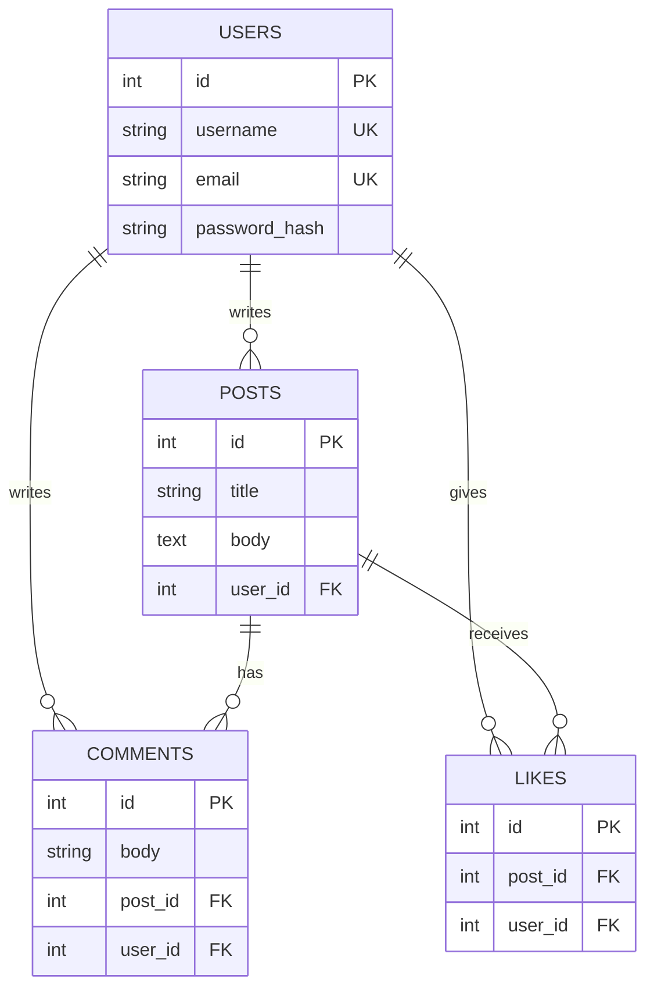

# Case study: building Postboard

## The brief
Turn a tutorial-grade React and Express posts app into something I would be comfortable showing an
employer: real accounts, a defensible data model, tests, documentation, and a couple of features that
demonstrate judgment rather than just CRUD.

## Starting point
The original project had posts and comments tables, a React client and no authentication. Anyone could
post as any username, the comments API was never used by the UI, and the database password was committed
in a config file. I treated those as the first three defects to fix.

## Key decisions and trade-offs

| Decision | Why | Trade-off |
| --- | --- | --- |
| SQLite locally, Postgres in production (free on Neon) | Anyone can clone and run it in one command, while serverless hosting (Vercel) needs a networked database | Two databases to keep compatible. Running the tests against real Postgres exposed identifier-quoting, case-sensitive `LIKE`, and date-formatting differences, which are now handled per dialect and covered by CI on both |
| Node's built-in `node:sqlite` through a small adapter | The native `sqlite3` package failed to install on a Windows machine (prebuilt download timed out, compile fallback needed the Windows SDK). Removing the native dependency made installs reliable | Requires Node 22.13+; the module is flagged experimental |
| JWT bearer tokens stored in `localStorage` | Simple to reason about and test | Exposed to XSS; httpOnly cookies with refresh tokens are the listed next step |
| zod on the API, Yup on the client | The server never trusts the client; the client gives instant feedback | Rules are written twice |
| Ownership enforced in the route handlers and covered by tests | UI hiding a button is not security | A little repetition; a policy layer would be the next refactor |
| AI summaries behind a server endpoint, provider-agnostic (OpenAI-compatible API, Anthropic optional) | Keeps the key private and cost bounded, and lets the project run on free-tier providers | In-memory cache and rate limit are per instance, so on serverless they are best effort |
| Express app wrapped as a single Vercel serverless function | One codebase serves local, Docker and Vercel; no rewrite into per-route functions | Cold starts; the database driver must be passed to Sequelize explicitly because bundlers cannot see its dynamic `require` |
| Thread text treated as untrusted data in the prompt | Posts are user input, so prompt injection is a realistic threat | Reduces but cannot fully eliminate the risk; output is labelled AI generated |
| Insights computed in SQL (CTE, correlated subqueries, `RANK()` window function) | The database is the right place to aggregate; shows the analysis rather than hiding it in app code | Requires SQLite 3.25+ or Postgres (any recent version) |
| Hand-written SVG chart | No charting dependency for one chart | Fewer features than a library |

## Data model

`likes` has a unique index on `(user_id, post_id)` so double-liking is impossible even under concurrent requests.

## KPI definitions

| KPI | Formula | Reading it |
| --- | --- | --- |
| Engagement rate | posts with at least one like or comment / all posts | Below about half suggests posts go unanswered |
| Comments per post | comments / posts | Depth of conversation |
| Likes per post | likes / posts | Low-effort appreciation |
| Posts per member | posts / members | Close to zero means most members only read |

## Quality
- 24 API tests (auth, ownership, validation, search and pagination, likes, comments, cascade deletes, AI summary with a fake client, analytics, docs) and 7 UI tests.
- GitHub Actions runs the tests against both SQLite and a real Postgres service, plus the production build, on every push.
- Secrets live in environment variables; the repository contains only `.env.example`.

## What I would do next
Tags and topic analysis, markdown rendering, a moderation role, email notifications, httpOnly cookie
sessions, and Playwright tests in CI.

## Findings from the data (fill in after you have real usage)
> The seed data is fake, so I have deliberately not reported results here. After deploying and inviting
> real users for a week, replace this section with: what the engagement rate was, which posts drove
> discussion, what you changed because of it, and what happened next. That before-and-after story is the
> part consulting interviewers care about most.
